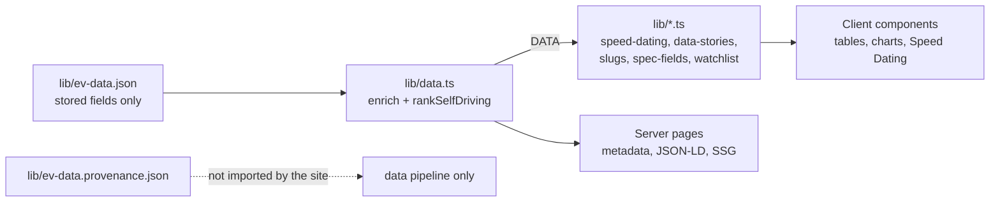
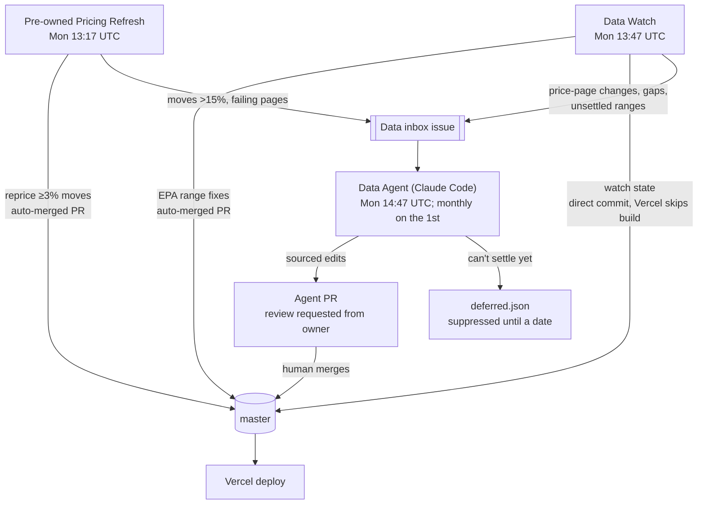

# ThreeRowEV: Architecture and Codebase

**Site:** https://threerowev.com · **Repo:** `dpm5045/ev-suv-comparison` (public) · **As of:** 2026-11-16 (`master` @ `0704645`)

This document explains what the app does, how it is designed and built, how its data stays current, and where the weak spots are. It is meant for a senior engineer reviewing the project cold. Section 9 lists the review findings and open questions.

---

## 1. What the app is

ThreeRowEV is a comparison site for **three-row electric SUVs sold in the US**. It covers 20 models and 165 trims across model years 2021–2027 (for example the Kia EV9, Rivian R1S, Tesla Model X and Y, Volvo EX90, Cadillac Escalade IQ and VISTIQ, Lucid Gravity, VW ID. Buzz, VinFast VF9, and upcoming models such as the Lexus TZ and Genesis GV90).

For each trim it records about 48 fields: price (new MSRP + destination, plus a used-price range), EPA range, battery and charging, performance, cargo volumes by seat row, dimensions, driver-assist capability, and in-car tech. It derives an estimated out-the-door (OTD) price for both new and used cars.

### Who uses it and how

The audience is families shopping for a 7- or 6-seat EV, most of them looking at used cars under $60k. The routes:

| Route | Purpose |
|---|---|
| `/` | **Speed Dating:** the user picks new or used, a budget, and two priorities (range, cargo, 0–60, charging speed, self-driving, 6-seat), and gets a ranked list of the cars that fit, scored only on the trims within budget. Below it are a hero image and a chart teaser. |
| `/comparison` | A filterable, sortable table of every trim. Phones get a card view. |
| `/side-by-side` | Pick 2–3 trims and compare them field by field. |
| `/spec-select` | Pick which fields to see across vehicles. |
| `/market-insights` | Four editorial chart stories (choice by year, price spread, range vs. price, cost per mile) and an interactive scatter-plot explorer. |
| `/news-radar` | Upcoming arrivals (a timeline), model-year changes, and departures (for example the Model X). |
| `/glossary` | Field definitions and the assumptions behind OTD. |
| `/vehicles/[slug]` | One static page per model (20) for SEO. |
| `/compare/[slug]` | One static page per pair of models (190) for SEO. |
| `/og` | Edge route that renders Open Graph images. |
| `/about`, `/privacy`, `/tech-stack` | Static content pages. |

There are no user accounts, no database, and no server-side state. The site is a statically generated, read-only app over one JSON file.

---

## 2. Stack and hosting

| Layer | Choice |
|---|---|
| Framework | **Next.js 14.2 (App Router)**, React 18, TypeScript (strict type check passes; `next lint` is clean) |
| Charts | Chart.js 4 via react-chartjs-2 |
| Styling | One global stylesheet, `app/globals.css` (~3,500 lines), with CSS custom properties for light and dark themes. One CSS module (`tech-stack`). |
| Data | `lib/ev-data.json` (~340 KB), imported at build time |
| Hosting | **Vercel**. Every push to `master` deploys; `vercel.json` skips builds for commits that touch only data-pipeline bookkeeping. |
| Analytics | Google Analytics via `NEXT_PUBLIC_GA_ID` (loaded only when set) |
| Automation | GitHub Actions (3 scheduled workflows) and Claude Code as an unattended data agent |
| Tests | Playwright smoke tests (13), `node --test` unit tests for the data pipeline (30), and a data validator that runs before every build |

Runtime dependencies are deliberately minimal: `next`, `react`, `react-dom`, `chart.js`, `react-chartjs-2`.

---

## 3. Application architecture

### 3.1 Rendering model

Almost everything is prerendered at build time: the build produces 227 static pages.

```
○ /, /comparison, /side-by-side, /spec-select, /market-insights, /news-radar, /glossary, …   static
● /vehicles/[slug] (20), /compare/[slug] (190)                                              SSG via generateStaticParams
ƒ /og (edge), /api/news (stub)                                                              dynamic
```

Each "tab" route is a **thin server component** (`app/<route>/page.tsx`). It sets metadata and JSON-LD and wraps a **client component** (`components/pages/*Client.tsx` or `components/tabs/*Tab.tsx`) in `<Suspense>`, because the clients read `useSearchParams()`.

The per-vehicle and per-pair pages are mostly server-rendered HTML with small client islands (`VehicleTrimSection`), which keeps their JavaScript small (~97 KB first load).

### 3.2 Data flow



`lib/data.ts` is the single entry point. It imports the JSON and exports one typed `DATA` object, and it computes fields at load that are **never stored**:

- **`otd_new`** = `(msrp + destination) × 1.06 + 905`. This assumes Pennsylvania: 6% sales tax plus $905 in fixed fees (doc $422, title/registration $233, EV road-use fee $250). The constants are `OTD_TAX_RATE` and `OTD_FIXED_FEES`.
- **`otd_preowned`**, **`preowned_low`** and **`preowned_high`** are parsed from the `preowned_range` string (`"$42,000 - $52,000"`) and get the same tax and fees.
- **`self_driving_rank`** and **`adas_downgraded`** come from `rankSelfDriving()` (section 3.4).

The validator fails the build if a computed field ever appears in the JSON.

The `DetailRow` interface in `lib/data.ts` is the schema. Other top-level keys are `count_data` / `count_totals` (trims per model per year), `us_ev_sales`, `preowned` (a parallel array of used-price rows), `glossary`, `assumptions`, and `last_updated` (which drives the sitemap's `lastModified`).

### 3.3 State management

There is no client store. **Filter state lives in the URL:** each client reads `useSearchParams()` and writes with `router.replace()` inside `startTransition`, so filters survive a refresh, links can be shared, and filter clicks don't add history entries. Old `/?tab=X` URLs and the renamed routes (`/watch-list`, `/explore`, `/data`) are permanent redirects in `next.config.mjs`.

Purely local UI state, such as the open detail panel (`detailIdx`), uses `useState`. The theme is read from `localStorage` by a small inline script in `<head>` before first paint, to avoid a flash of the wrong theme. `useIsLightTheme` exposes it to the charts.

### 3.4 Domain logic worth knowing

**Speed Dating (`lib/speed-dating.ts`)** is a set of pure functions with no React.

1. **Filter rows, then summarize.** Rows are filtered by condition, budget bucket and the 6-seat pick. `summarizeInBudget()` then builds one summary per vehicle *from only those rows*, so a car is never scored on a trim the user can't afford.
2. **Score each metric as a share of the best.** `normalizeScores()` gives each car `value / best` (or `best / value` where lower is better: 0–60 and charge time). This replaced min-max scaling, which always gave the last car in the room 0. Only missing data scores 0.
3. **Combine and rank.** The first pick weighs 60%, the second 40%, and ties share a rank (dense ranking).

**Self-driving rank (`lib/data.ts`)** works from a four-step tier ladder in `TIER_RANK`: Basic L2, Advanced L2, L2+ Hands-Free, L2+ Point-to-Point. That map is the only tier ordering in the codebase.

- Each row can carry `adas_hardware`, `adas_hardware_gen` (`current` / `previous` / `mixed`) and `adas_hardware_note`.
- A row on older hardware (`previous`, or `mixed` when the buyer can't be sure) that offers the *same tier* as that vehicle's current hardware ranks one step lower. For example, Tesla HW3 cars sit below HW4 cars.
- Older hardware that already has a lower tier (Rivian Gen 1) isn't lowered a second time.
- Every view ranks by `self_driving_rank`.

**Cargo and seating fields are protected.** `seats`, the `cargo_behind_*` fields, `fold_flat` and `cargo_floor_width_in` are set per seat configuration and must never be changed automatically. The pipeline and the agent's instructions both enforce this.

### 3.5 Module map

```
app/                     routes (server components), sitemap, robots, manifest, OG route, error/not-found
components/
  pages/                 route-level client wrappers (Home, Comparison, SpecSelect)
  tabs/                  feature UIs: OverviewTab (Speed Dating), ComparisonV2Tab, SideBySideTab,
                         SpecSelectTab, WatchListTab (News Radar), GlossaryTab
  DataStories, DataExplorer   Market Insights charts
  DetailPanel, VehicleSummaryPanel, VehicleTrimSection, SpecSection   shared detail views
  Header, DashboardNav, Footer, Breadcrumb, PageHeader, VehicleBadge, JsonLd, GoogleAnalytics
lib/
  data.ts                types, enrichment, self-driving rank, watch/goodbye lists
  speed-dating.ts        home-page ranking engine
  data-stories.ts        chart data and generated headlines for Market Insights
  spec-fields.ts         field registry: labels, sections, formatting for spec tables
  slugs.ts               URL slugs, vehicle lookups, comparison pairs, SITE_URL
  vehicle-theme.ts       per-brand colors (badges and charts), one source
  watchlist.ts           editorial metadata for upcoming vehicles (status, arrival window, blurb)
  utils.ts               fmtMoney / fmtNum / fmtDate → { text, className }
```

The largest components are `SpecSelectTab` (~700 lines), `DataExplorer` (~660), `ComparisonV2Tab` (~620) and `OverviewTab` (~460).

### 3.6 Responsive design and theming

- The design is mobile-first in the places that matter. The comparison table renders as both a desktop `<table>` and a mobile card grid, and a CSS-class toggle switches between them.
- The Speed Dating bars use a fixed grid (`76px minmax(48px,1fr) minmax(84px,max-content)`) so long labels wrap instead of overflowing. A Playwright test checks for horizontal overflow at phone width.
- The hero image serves WebP with PNG fallbacks, and phones get a separate portrait crop.
- Light and dark themes are CSS custom properties keyed on `data-theme`. Brand colors come from `CLASS_THEMES` and have to match the CSS classes, which is a manual sync (section 9).

### 3.7 SEO and metadata

- Per-route `metadata` and per-model / per-pair `generateMetadata`.
- JSON-LD for WebSite, Organization and the vehicle pages.
- A sitemap generated from the data, `robots.ts`, and dynamic Open Graph images on the edge.
- Counts in titles and descriptions are computed from the data, never hardcoded. The codebase follows this rule throughout.

### 3.8 Security posture (site)

- **Static output.** There are no forms, no auth and no user input stored anywhere.
- **Response headers** (`next.config.mjs`): `X-Content-Type-Options`, `X-Frame-Options: DENY`, HSTS with preload, `Referrer-Policy` and a restrictive `Permissions-Policy`. There is **no Content-Security-Policy**.
- **`/api/news`** used to proxy the Anthropic API. It is now a stub that returns 404, and the API key is no longer needed.

---

## 4. The data

### 4.1 Shape and conventions

- **One row per trim per model year.** `name` is the key, in the form `"Vehicle, Year, Trim"`.
- **Many numeric fields are typed `number | string | null`**, because they carry sentinels:
  - `"TBD"` means not announced yet.
  - `"N/A - Not New"` means the model year is no longer sold new (for example Model X 2025–26, now used-only). The last known price is kept in `notes`.
  - Free-text estimates appear in a few places.

  The formatters in `lib/utils.ts` handle these sentinels in one place.
- **Prices:**
  - `msrp` excludes destination; `destination` is stored separately.
  - Tesla's destination is $1,640 ($1,390 destination + $250 order fee).
  - Some manufacturer pages print prices with destination included. The pipeline knows which ones (`prices_include_destination` in `sources.json`).
- **Used prices** are a display string (`"$42,000 - $52,000"`) stored twice: on the detail row and in the parallel `preowned` array. The two must match, and the validator checks it.

### 4.2 Provenance: "no source, no change"

`lib/ev-data.provenance.json` (~75 KB) is the audit trail. The site does not import it.

- **`fields`**: for each row and field, a `{ source_url, verified_on, evidence }` record. The evidence is a verbatim quote from the source page.
- **`preowned`**: the CarGurus baselines the used-price script compares against.

The rule for every automated or agent-made change is: **no fetched source with a quote, no change.** The approved source list is in `CLAUDE.md`:

| Field | Source |
|---|---|
| Prices | The manufacturer's US site. Car and Driver's per-trim pages are allowed only for manufacturers that block automated requests (Tesla). |
| Ranges | EPA (fueleconomy.gov) |
| Used prices | CarGurus price-trend pages, read by script |

### 4.3 Validation

`scripts/validate-data.js` runs as `prebuild`, so a bad data edit fails the Vercel build. **Errors** block the build:

- required fields are missing on non-pre-release rows;
- a computed OTD field is stored;
- the `adas_*` keys are invalid;
- `count_totals` doesn't equal the column sums of `count_data`;
- `details` and `preowned` are out of sync;
- the provenance file has problems.

**Warnings** are informational: duplicate names, numbers outside a plausible range (for example a range under 150 mi or an MSRP over $200k), and low completeness. Currently 119 of 165 rows are fully populated; most gaps are 2027 pre-release rows.

`count_data` itself is not checked against the actual detail rows. That is a manual step in the `CLAUDE.md` checklist.

---

## 5. The data pipeline (keeping the data current)

This is the most involved part of the system. It was rebuilt on 2026-11-14 to 16, replacing a manual monthly `/refresh` session with a weekly pipeline that mostly runs itself. The design principle: **use deterministic scripts wherever a rule can decide, and an LLM agent only for research. A person reviews only the agent's PR.**



### 5.1 Pre-owned repricing (`scripts/refresh/preowned.mjs`)

- Fetches each vehicle's CarGurus price-trends page (`lib/cargurus.mjs` parses the table) and maps model-year averages to our rows (`lib/preowned-plan.mjs`).
- **Thresholds:** moves under 3% from the stored baseline are ignored as noise. Moves over 15% are not applied; they go to the inbox for a person or the agent. `--allow-large "Vehicle|Year"` applies one deliberately.
- A page that fails on two runs in a row is reported to the inbox (`state/preowned.json`).
- The workflow opens a data-only PR and merges it straight away. Validation must pass, and only the two data files may change.

### 5.2 Data Watch (`scripts/refresh/watch.mjs`)

- **EPA range check.** Downloads EPA's vehicle file (`lib/zip.mjs` is a small dependency-free unzip) and compares each stored `range_mi` with EPA's figure. Two-row and three-row variants are matched by seat count.
  - With `--fix-ranges` it corrects a mismatch on its own, but only when an earlier EPA match shows which variant the trim is, and only for changes of 15% or less (`planRangeFixes` in `lib/epa.mjs`).
  - Rows that are knowingly manufacturer estimates are listed in `accepted.json`.
- **Price-page watch.** Fetches manufacturer pages and Car and Driver pages listed in `sources.json`, extracts prices, and diffs them against the last snapshot (`state/watch.json`).
- **Standing price gaps.** Lists models whose stored starting price differs from Car and Driver's, or where Car and Driver prices a model year we don't carry. Car and Driver acts as a tripwire, not a source.
- **Output.** Range fixes go through an auto-merged PR. Bookkeeping is committed directly to `master`, and Vercel skips that build. Everything else is posted to the inbox issue (`inbox.sh` creates or appends to the one open issue labelled `data-inbox`). A page that fails twice is marked `unavailable` instead of raising alarms every week.

### 5.3 Data Agent (`.github/workflows/data-agent.yml`)

Runs Claude Code (via `anthropics/claude-code-action`) unattended, following `.claude/commands/refresh-ci.md`.

- **Inbox mode (weekly):** every inbox item must end in exactly one outcome: Fixed (with a quoted source), Confirmed, Accepted, or Deferred (to `deferred.json` with an `until` date, plus `needs_local` when the source blocks cloud runners).
- **Monthly mode (the 1st):** a full pass covering new model years, filling gaps, and the News Radar list.

**Tools.** The agent reads pages only through `scripts/refresh/fetch-page.mjs`, which enforces a domain allowlist. WebSearch is for finding pages, never a source on its own. Fetched content is treated as data, and the instructions say to ignore any instructions found in pages. Before the agent starts, `probe-sources.mjs` records which sites answer from the runner, because cloud IPs get blocked: Tesla, InsideEVs and cars.com return 403.

**Security layout.** The credential (`CLAUDE_CODE_OAUTH_TOKEN`) is confined to one job:

| Job | Credential | Can write repo | Runs npm | Role |
|---|---|---|---|---|
| `plan` | no | no | no | Decide whether to run: inbox empty? agent PR already open? backup already satisfied? |
| `agent` | **yes** | no (read-only checkout, `persist-credentials: false`) | **no** | Run Claude, then scan its own output for the credential before handing over a patch |
| `verify` | no | no | yes | Apply the patch, `npm ci`, unit tests, full `next build` |
| `publish` | no | yes | **no** | Push the branch, open the PR, assign and request review from the repo owner, close the inbox |

Every third-party action is pinned to a commit SHA. The inbox text passed to the agent is filtered to bot-authored content only, because the repo is public and anyone can comment on an issue.

### 5.4 Scheduling reliability

GitHub's cron is best effort, and on 2026-11-16 it dropped all three Monday runs. So the schedules now:

- run **off the hour**: :17, :47 and :23;
- each have a **backup a day later** (Tuesday, and the 2nd of the month for the monthly pass) that runs only if `scripts/refresh/ran-since.sh` finds no successful run since the first schedule.

Agent runs carry their mode in `run-name`, so the monthly backup only counts monthly runs.

### 5.5 Human touchpoints

| What | How often |
|---|---|
| Review and merge the agent's PR | Weekly when it finds something; GitHub notifies the owner |
| Product decisions the agent flags (for example "price these trims?") | Occasionally, through the inbox or PR |
| `deferred.json` items marked `needs_local` | When they come up; needs a session on a home connection |
| `/sync-sheet` | As wanted. Refreshes a browsable backup of every table in a Claude Sheet; git remains the source of truth |

### 5.6 Claude Code commands (`.claude/commands/`)

These are written instructions for running Claude Code by hand, not code:

| Command | Purpose |
|---|---|
| `refresh.md` | The full research rules, including what counts as a source |
| `refresh-ci.md` | The unattended agent's version |
| `add-vehicle.md`, `add-field.md` | Schema and data change checklists |
| `update-pricing.md`, `scan-watchlist.md`, `spot-check.md`, `validate.md` | Narrower data tasks |
| `sync-sheet.md` | The backup Sheet |

---

## 6. Testing and quality gates

| Gate | Where it runs | What it covers |
|---|---|---|
| `validate-data.js` | `prebuild` (every Vercel build), the pipeline workflows, and the agent's `verify` job | Data integrity (section 4.3) |
| `npm run test:refresh` | Every pipeline workflow before it runs; the agent's `verify` job | 30 unit tests: CarGurus parsing, repricing thresholds, EPA matching (seat variants, range-fix anchors), price extraction, destination handling, gap detection. Uses HTML and EPA fixtures. |
| `next build` | Vercel; the agent's `verify` job | Type check and static generation of all 227 pages |
| `tsc --noEmit`, `next lint` | Local only | Both clean today |
| Playwright `tests/e2e/smoke.spec.ts` | **Local only** | 13 smoke tests: every route renders, the redirects work, the Market Insights charts mount, and Speed Dating doesn't overflow at phone width |

There are **no unit tests for the app's own logic**: `lib/speed-dating.ts`, `rankSelfDriving`, `data-stories`, OTD math and formatters.

---

## 7. Repository layout (top level)

```
app/ components/ lib/        the site
public/                      hero images (WebP + PNG fallbacks, ~6 MB total), favicon
scripts/
  validate-data.js           prebuild validator
  refresh/                   the data pipeline (section 5), its tests, fixtures, state, sources.json
  export-sheet.mjs           CSV export for the backup Sheet
  *.mjs (root of scripts/)   one-off historical migrations (add fields, merge cargo, backfills)
  lib/                       older pipeline helpers (validator, OTD calculator, PR builder): unreferenced
  archived/                  retired refresh scripts
tests/e2e/                   Playwright smoke tests
.github/workflows/           preowned-refresh, data-watch, data-agent
.claude/commands/            agent and operator instructions
docs/                        reports, design specs, reference material
CLAUDE.md                    working conventions for AI-assisted development (also the best quick reference)
```

History: 354 commits since 2026-03-14. Development is AI-assisted through Claude Code, and `CLAUDE.md` is kept up to date as the working spec.

---

## 8. Design decisions and their rationale

| Decision | Why | Trade-off |
|---|---|---|
| JSON file in git, no database | A small dataset (165 rows) that changes weekly; git gives history, diffs, review and rollback at no cost | Schema changes are manual migrations; the whole dataset ships to the client (below) |
| Static generation for everything | Fast, cheap, SEO-friendly; the data only changes at deploy time | Every data change is a deploy (mitigated by Vercel's ignore rule) |
| Derived fields computed at load, never stored | One formula, no drift between stored and derived values | Every consumer must go through `lib/data.ts` |
| Filter state in the URL | Shareable, survives refresh, no store library | Every client page needs a `<Suspense>` boundary |
| Scripts for rules, an agent for research, a person for review | Deterministic where possible; an LLM only where judgment is needed, and always behind a PR | The agent's work depends on which sites answer cloud runners |
| Provenance file kept separate from the data | Keeps the site bundle small; makes audit trail and data reviewable separately | Two files must be kept in step (the pipeline handles it) |

---

## 9. Review findings and open questions

The review found these while preparing this document. They are ordered roughly by how much they matter.

### Worth addressing

1. **No CI on pull requests for the app.** Lint, `tsc`, the Playwright smoke tests and the app's logic run only locally. Vercel's preview build (which runs the validator and `next build`) is the only automatic gate on a human-authored PR, and the smoke tests never run in CI. Suggestion: a small `ci.yml` that runs lint, `tsc`, `test:refresh`, build and the Playwright suite (headless) on every PR.
2. **The whole dataset ships to the browser.** Client components import `DATA`, so the full ~340 KB JSON (about 270 KB minified, one shared chunk) is in the JavaScript of every interactive route. It is acceptable at this size: `/` has 133 KB first-load JS after compression. But it grows linearly with trims and fields. Options: project only the fields each view needs into a smaller module, or move the heavy views to server components and pass props.
3. **A third-party copyrighted PDF is committed to a public repo:** `docs/reference/2026 Tesla Model X Ratings & Specs - Consumer Reports.pdf`. It should be removed, and arguably purged from history.
4. **No Content-Security-Policy.** Other security headers are present. A CSP is a reasonable next step: the site loads only Google Analytics, and has one inline theme script that would need a hash or nonce.
5. **No unit tests for the scoring and ranking logic.** `speed-dating.ts` and `rankSelfDriving` are pure functions and easy to test. Both had real bugs found by eye this week (min-max scoring gave the runner-up 0).

### Housekeeping

6. **Dead code:**
   - `components/tabs/AccessoriesTab.tsx` and `lib/affiliate.ts` are not imported by any route.
   - `scripts/lib/*` (an old validator, OTD calculator and PR builder) is not referenced anywhere.
   - `scripts/archived/` and the one-off migration scripts at the root of `scripts/` are history.
7. **Report HTML at the repo root:** `explore.html`, `market-insights.html` and `update-*.html` are tracked in git and belong in `docs/reports/` or nowhere.
8. **Documentation drift:** `CLAUDE.md` still describes `/api/news` as a live Anthropic proxy, but it is a 404 stub. Either delete the route or fix the doc.
9. **Next 15-style `params: Promise<…>` on Next 14** in the dynamic routes. It works, because awaiting a plain object is harmless, but it is wrong for the installed version. It does make a Next 15 upgrade easier.
10. **Large components and one large stylesheet.** `SpecSelectTab`, `DataExplorer` and `ComparisonV2Tab` are each 600–700 lines, and `globals.css` is about 3,500 lines. They work, but are the likeliest places for regressions.
11. **Manual sync points** between `VEHICLE_CLASSES` / `CLASS_THEMES` and the CSS brand classes. The validator doesn't check that the CSS classes exist. Adding a vehicle means touching all three (documented in `CLAUDE.md`).
12. **Mixed-type numeric fields.** Sentinels such as `"TBD"` and `"N/A - Not New"` in `number | string | null` fields push type checks into every consumer. A discriminated shape such as `{ value: number } | { status: 'tbd' | 'not_new' }`, or separate status fields, would be cleaner. It is a sizeable migration for modest gain.
13. **Hero PNG fallbacks** total about 6 MB in `public/`. Browsers that need the PNG fallback are now rare. The PNGs could be dropped or recompressed.
14. **Node versions:** CI uses Node 22 and local development has used Node 26. Pinning one version (`.nvmrc` or `engines`) would avoid surprises.

### Questions for the reviewer

- Is the **agent's security layout** sufficient, given that it runs on a public repo with a long-lived OAuth token (section 5.3)? Specifically: is limiting the inbox to bot-authored text, plus the fetch allowlist and the instruction to treat pages as data, enough mitigation against prompt injection from fetched web pages, given that a person reviews every PR?
- Should **auto-merged data PRs** (used prices, EPA range fixes) also require a passing Vercel preview build before merging, rather than relying only on the validator?
- At what dataset size does the client-bundle concern (item 2) justify restructuring?
