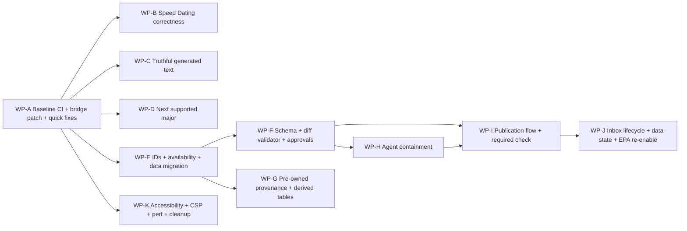

# ThreeRowEV: Remediation Build Spec (v2)

**Responds to:** "ThreeRowEV architecture and codebase audit" (2026-11-16, revision `0704645`) and "Review of ThreeRowEV remediation build spec" (2026-11-16).
**Status:** v2, with the review's required revisions applied. **WP-A, WP-B and WP-C are approved to build.** The other work packages need sign-off on their revised designs, but the review's corrections are folded in.

**Decisions taken:**
- **D1: no 5-seat configurations in Speed Dating.** The reviewer recommended this and it was the original proposal. It is easy to reverse: one constant.
- **D2: the PDF is removed with no history purge.** Any rewrite of history is a separate rights decision for the owner.
- **D12: `/api/news` is deleted.**

Open items are marked **[OPEN]**.

## What changed from v1

| Review item | Change in v2 |
|---|---|
| Strict phase order | Replaced by **work packages with explicit dependencies** (below). Security maintenance and tests no longer wait on unrelated work. |
| Minimal CI and test runner later | Moved into **WP-A, first**. Vitest (with an `@` alias) is used for app and domain code; `node --test` stays for the pipeline. |
| Next major upgrade last | Now **WP-D**, right after WP-A gives it a test harness. The 14.2.35 bridge is in WP-A. |
| Availability migration guessed from price (1.2) | Availability, price and price meaning are modelled separately. Unknowns become `needs_review`, with a migration review table and no guessing (WP-E). |
| `Allow-Protected` in PR text (1.3) | Removed. Exceptions need **maintainer approval bound to SHA, ID, field and values**, outside anything the proposal controls (WP-F). |
| Containment claims (2.x) | Rewritten as **requirements to verify** with canary tests. Adds OS-level isolation, fixed-path wrappers and explicit data roots. The secrecy claim is deleted (WP-H). |
| Publishing state transitions (3.x) | Concrete **proposal-artifact → verify → narrow writer** flow, with immutable SHAs, a named check, `queue: max`, outcome resolution after durable publish, and `work_performed` (WP-I, WP-J). |
| Schema versus existing data (1.3, 1.4) | Uses sentinel unions for no-market values; distinguishes **observed from derived** provenance; extends the pre-owned producer; allows same-day re-verification; resolves the `scripts/lib` contradiction (WP-E, WP-F, WP-G). |
| Scoring details | **No cargo fallback.** Requires 6+ known seats; rejects non-finite and non-positive inputs; de-duplicates preferences; uses an ID tie-breaker once IDs exist (WP-B). |
| Output tests | Assert on structured values and basis, not on scanning for comparative words. Covers vehicle pages, compare pages and OG labels (WP-C). |
| CSP | Defines collection, inline styles and the exact final header (WP-K). |
| Pause and rollback | Publication is gated by a **compatibility version**, `workflow_dispatch` included. Rollback is tested end to end (WP-E). |

## Work packages and dependencies



| WP | Contents | Audit findings | Status | Size |
|---|---|---|---|---|
| **A** | Baseline CI, Vitest, Next 14.2.35, EPA auto-fix pause (fail-closed), JSON-LD escaping, EX90 count, PDF removal, doc corrections | F1 (bridge), F4 (pause), F8 (baseline), F10 (part) | **Build now** | 1–2 days |
| **B** | Speed Dating scores real configurations; condition is independent of budget | F5, F6 | **Build now** | 1–2 days |
| **C** | Tie-aware text; honest range basis (interim); visible FAQ | F7 | **Build now** | 1 day |
| **D** | Upgrade to Next 16.x (supported) with React 19 | F1 | After A | 2–3 days |
| **E** | Stable IDs; availability, price status and range basis; migration with review table; compatibility gate | F3, F4, F6, F7 | Revised design | 3–4 days |
| **F** | Schema; diff validator; trusted approvals | F3 | Revised design | 3 days |
| **G** | Pre-owned producer provenance; derived counts and pre-owned table | F3, F9 | Revised design | 2 days |
| **H** | Agent containment, verified with canaries | F2 | Revised design | 3–5 days |
| **I** | Proposal → verify → writer flow; required check; serialized writers | F8, F9 | Revised design | 3–4 days |
| **J** | Inbox item lifecycle; `data-state`; EPA auto-fix on reviewed mappings | F4, F9 | Revised design | 3 days |
| **K** | Accessible drawer; CSP; performance baseline; cleanup | F10 | After A | 3–5 days |

---

## WP-A: Baseline CI, bridge patch, quick fixes (build now)

### A.1 Baseline CI and test runner
- `.github/workflows/ci.yml` runs on `pull_request` and on `push` to `master`. It uses Node from `.nvmrc` (22) and runs:
  1. `npm ci`;
  2. `npx eslint .` (explicit, so it survives Next 16 removing `next lint`);
  3. `npx tsc --noEmit`;
  4. `npm run test:refresh`;
  5. `npm run test:unit`;
  6. `npm run build`;
  7. Playwright against `next start` (production) on a fresh server.
- `playwright.config.ts`: `webServer.command` = `npm run start` in CI (after build) and `npm run dev` locally; `reuseExistingServer: !process.env.CI`.
- **Vitest** (dev dependency) with `resolve.alias['@']` = the repo root. Tests go in `tests/unit/**/*.test.ts`. `npm run test:unit` = `vitest run`. Pipeline tests stay on `node --test`.
- Add `.nvmrc` (`22`) and `engines.node: ">=22 <23"`. Every workflow uses `node-version-file: .nvmrc`.
- **Branch protection is not changed in WP-A.** The required-check name and its trusted source are settled in WP-I. Until then, CI is advisory, and the owner merges only when it is green.

### A.2 Next.js bridge patch
- `next@14.2.35` (the last 14.x release, which fixes the December 2025 App Router DoS advisory) and `eslint-config-next@14.2.35`. Record `npm audit --omit=dev` output in the PR.
- This is a bridge only: WP-D moves to a supported major.

### A.3 Pause EPA auto-fix; fail closed
- Remove `--fix-ranges` from `data-watch.yml`; the mismatches are still reported.
- `candidatesFor` in `scripts/refresh/lib/epa.mjs`:
  - if the row's drivetrain is known and no variant matches it → `[]`;
  - if the variants are seat-specific and none match the row's seats → `[]`.

  An empty result means the row is `unmatched` and goes to the inbox. There is no fallback to all variants.
- **Tests:** a wrong-drive row and a wrong-seat row are never `consistent` and produce no fix.

### A.4 JSON-LD escaping
- `JsonLd.tsx`: `JSON.stringify(data).replace(/</g, '\\u003c')`.
- **Test:** a payload containing `</script>` stays one script element and parses back to the same object.

### A.5 Data and hygiene
- EX90 2026 count: 6 → 5, and the total: 166 → 165. WP-G derives counts so this can't recur.
- Remove `docs/reference/2026 Tesla Model X Ratings & Specs - Consumer Reports.pdf` (D2: no history rewrite).
- Delete `app/api/news/route.ts` (D12).
- Documentation corrections in `CLAUDE.md` and `docs/ARCHITECTURE.md`: `name` isn't unique; the validator's real scope; SideBySide uses `router.push`; DataExplorer has local filter state; no news API; runtime endpoints exist (`/og`).

---

## WP-B: Speed Dating correctness (build now; needs A.1)

### B.1 Score real configurations
`lib/speed-dating.ts` holds pure functions; none imports `DATA`.

1. **Row metrics.** `rowMetric(row, pref)` returns a finite positive number or `null`:
   - `range_mi`;
   - `zero_to_60_sec` (lower is better);
   - **`cargo_behind_3rd_cu_ft` only, with no fallback to the 2nd row.** A missing value is unknown and scores 0;
   - `dc_fast_charge_10_80_min` (lower is better);
   - `self_driving_rank`.

   Non-numeric, non-finite, zero or negative values are `null`.
2. **Preferences.** De-duplicate them (`pref1 === pref2` → one preference). `sixseat` is a filter, not a metric.
3. **Normalization across eligible rows.** `best` = max or min over the non-null values. Score = `v/best`, or `best/v` where lower is better; `null` = 0.
4. **Composite per row:** `0.6·s1 + 0.4·s2`, or `s1` with one preference.
5. **One row per vehicle.** The highest composite wins. Tie-breakers, in order: lower budget price, newer year, then `id` once WP-E lands (row index until then).
6. **Rank vehicles** by their chosen row (dense ranking).
7. **Display the chosen row:** year, trim, seats, price and metric values. Model-level context is labelled as such ("N trims fit · $X–$Y").

### B.2 Eligibility, independent of budget
`lib/selection.ts` is used by Speed Dating and by Spec Select's condition filter.

- `eligibleRows(rows, { condition, budget, sixSeat })`:
  - Excludes Watch List vehicles in both modes.
  - **Speed Dating requires `seats` to be a known number ≥ 6** (D1). Null seats are excluded.
  - `new`: currently sold new. Until WP-E, this means `typeof msrp === 'number'` **and** the model year is at least `DATA.last_updated`'s year minus 1. WP-E replaces this with `availability`.
  - `preowned`: `hasPreowned(row)`, plus the budget on `preowned_low`.
  - The budget applies when it isn't `all`, independently of the condition.
- `parseSpeedDatingParams(searchParams)`: unknown values fall back to the documented `SPEED_DATING_DEFAULTS`.

> The interim "sold new" rule (a numeric MSRP *and* a recent model year) is a heuristic. WP-E's explicit `availability` field replaces it. The year cut-off keeps 2022–2023 R1S rows with historical prices out of New today.

### B.3 Tests (Vitest, with fixtures)
- The audit's three examples (EV9, R1S, Model X): range and 0–60 come from the same row.
- A missing third-row cargo value scores 0, not the second-row figure.
- Duplicate preferences; non-finite and zero values; ties and tie-breakers; one versus two preferences.
- Budget edges ($60,000 exactly); the six-seat filter; null seats excluded.
- `/?condition=new&budget=all&pref1=range&pref2=power` excludes used-only rows and the Model X. Switching from Pre-owned to New gives the same result; invalid parameters resolve to the defaults.

---

## WP-C: Truthful generated text (build now; needs A.1)

- `lib/compare-text.ts`:
  - `compareMetric(a, b, { lowerIsBetter }) → { winner: 'a' | 'b' | 'tie' | null, a, b }`;
  - text builders that return tie wording for equal values.
- **Range basis, interim.** `rangeBasis(row)` returns `'manufacturer_estimate'` when the row is in `scripts/refresh/accepted.json`, otherwise `'epa'`. Range text built over a span reports the basis per part. Example: "EPA range 253–300 mi; Lexus estimates up to 315 mi for the Premium". WP-E replaces this lookup with the stored field.
- Used by:
  - `app/compare/[slug]` (FAQ, metadata, visible copy);
  - `app/vehicles/[slug]` (metadata description, FAQ, the "EPA Range" stat label);
  - `app/og` labels.
- **Visible FAQ.** Every JSON-LD FAQ entry is rendered visibly, from the same array.
- **Tests:**
  - Unit tests on the builders: equal values give tie text; a mixed-basis span names both bases.
  - Post-build tests load the generated HTML for every `/compare/*` and `/vehicles/*` page, parse the JSON-LD and the visible FAQ, and check them against expected values computed from the data with the same helpers:
    - every winner claim is a strict inequality on the structured values;
    - no range from an accepted-estimate row is described as EPA;
    - visible and JSON-LD FAQ text match.
  - Page-count equality (227) is a baseline smoke check only.

---

## WP-D: Next.js supported major (after A)

- **Target:** the current 16.x line (16.4.6 as of 2026-11-16). Choose the exact patch from current advisories when work starts.
- **Migration points:**
  - React 19 plus compatible `react-chartjs-2` and `@types/react`;
  - async request APIs (`params` is already typed as a Promise);
  - **`next lint` is removed**, so ESLint is run explicitly (done in A.1); flat config if required;
  - the build no longer runs linting.
- **Bundle-size checks** (WP-K) read from the build's machine-readable output, or from measured transfer, not from the console's First Load JS table. Verify which format the target version produces.
- **Acceptance:**
  - CI is green (unit, pipeline, build, Playwright);
  - `npm audit` is reviewed;
  - Vercel preview checks of redirects, metadata, the generated pages, charts and OG images.

---

## WP-E: IDs, availability, price status, range basis (revised)

### E.1 Stable IDs
- `id` on every `details` row. It is a slug assigned **once** by migration and never regenerated: `<vehicle>-<year>-<trim>[-<seats>s]`, with the seat suffix only where needed for uniqueness. It must be unique and match `^[a-z0-9-]+$`.
- Every consumer keyed by `name` moves to `id`: provenance, `applyRangeFixes`, `planRangeFixes`, `updateRangeProvenance`, the export, tests and fixtures. `name` becomes a display label only.
- **Side-by-side (D3):** resolve selections to IDs internally now, and keep parsing the legacy `v/y/s/t` parameters. The public URL format doesn't change in this package.

### E.2 Availability, separate from price

| Field | Values | Meaning |
|---|---|---|
| `availability` | `new` · `used_only` · `announced` · `needs_review` | Whether you can buy this configuration new **today** |
| `msrp` | `number \| null` | The MSRP when known, **including published prices for announced models** (Lexus TZ keeps $62,500, $70,500 and $79,000) |
| `msrp_status` | `current` · `historical` · `announced` · `unknown` | What the number means. `historical` is the last new price of a configuration no longer sold new |
| `range_basis` | `epa` · `manufacturer_estimate` · `unverified` · `null` | What `range_mi` is |

**Migration rules** (`scripts/migrations/2026-11-availability.mjs`):

| Current state | `availability` | `msrp` / `msrp_status` |
|---|---|---|
| `msrp: "N/A - Not New"` | `used_only` | `null` / `unknown`. If `notes` hold the last price, the migration lists it in the review table for a person to confirm. It never moves it automatically. |
| Watch List vehicle | `announced` | Numeric → kept / `announced`. `TBD` → `null` / `unknown` |
| `msrp: "TBD"` (not Watch List) | `needs_review` | `null` / `unknown` |
| Numeric msrp, model year ≥ the data year minus 1 | `needs_review` until confirmed | Kept / `current` |
| Numeric msrp, older model year (for example the 2022–23 R1S) | `needs_review` | Kept / `historical` |

- **No row becomes `new` automatically.** The migration writes `docs/migrations/2026-11-availability-review.md`: every row, with old values, proposed values, and the evidence it can find (source URL and verification date from provenance). The owner (or the agent, with sources, through a normal reviewed PR) resolves each `needs_review` row to `new`, `used_only` or `announced`.
- Until a row is resolved, `needs_review` is **not eligible for New in Speed Dating**. Tables show it with a "status unconfirmed" marker.
- **Range basis precedence:**
  1. listed in `accepted.json` → `manufacturer_estimate`;
  2. otherwise a range provenance record from fueleconomy.gov *with a reviewed EPA mapping* (WP-J) → `epa`;
  3. otherwise (including every record written by the old name-keyed matcher) → `unverified`.

  Generated text says "range" for `unverified` and "EPA range" only for `epa`.
- **Provenance re-key.** Records are copied from a name key to every sibling ID, marked `"legacy": "name_keyed"`. A legacy record **cannot** set `range_basis: epa` and **cannot** act as an anchor or mapping for automatic EPA updates.

### E.3 Compatibility gate (pause and rollback)
- `ev-data.json` gains `schema_version` (2 after this package). Every publisher, scheduled or `workflow_dispatch`, reads `scripts/refresh/compat.json` (`{ "accepts_schema": [2] }`) **from the checked-out code** and refuses to publish if the data's version isn't accepted. This is what makes the pause real while code and data change.
- **Rollback test,** before merge, on a branch:
  1. migrate;
  2. run each publisher in dry-run mode;
  3. revert code and data together;
  4. confirm the publishers run against version 1 again;
  5. confirm the site builds.

  Rollback is documented as reverting the whole PR (code, data, compatibility file and workflows together), never the JSON alone.

---

## WP-F: Schema, diff validator, trusted approvals (revised)

### F.1 Schema (`scripts/schema/ev-data.schema.mjs`)
This is a new directory, so nothing collides with the WP-K deletions. Those are named explicitly: `scripts/lib/data-validator.mjs`, `scripts/lib/otd-calculator.mjs` and `scripts/lib/pr-builder.mjs`.

- Every field is typed. Numeric fields allow `number | null` plus a **per-field enumerated** sentinel set.
- **`preowned_range`** = a range string matching `^\$\d{1,3}(,\d{3})* - \$\d{1,3}(,\d{3})*$` or a single price, with low ≤ high and within $5k–$250k, **or** one of the enumerated no-market sentinels. The migration normalizes today's three phrasings to one: `No used market yet`. Moving to stored numeric low/high plus a status is optional, and later.
- Unknown keys and stored computed keys are errors. Enums: `availability`, `msrp_status`, `range_basis`, `adas_hardware_gen`, `self_driving_tier`.
- `lib/data.ts` drops the double assertion in favour of `satisfies`, for compile-time typing.

### F.2 Diff validator (`scripts/validate-diff.mjs --base <sha> --head <sha>`)
It takes **immutable SHAs** and fetches the history it needs. It never uses `origin/master`. It has two modes:

- `--mode data-proposal` (automated publishers and the agent): every rule below is enforced.
- `--mode code-pr` (human PRs): the schema plus a report of data changes; protected-field changes are allowed, because a human authored the PR and reviews it.

| Rule (data-proposal mode) | Result |
|---|---|
| Protected field changed (`seats`, `cargo_behind_*`, `fold_flat`, `cargo_floor_width_in`) | **Error.** No in-band override. |
| Row removed or `id` changed | **Error**, unless a trusted approval exists (F.3). |
| `availability` → `used_only`, or `announced` → `new` | **Error**, unless a trusted approval exists. |
| Sourced field changed or new row added without a provenance record whose `value` equals the stored value | **Error** |
| Wrong source category for the field (see the source policy) | **Error** |
| Evidence deleted, value mismatch, `legacy` record relabelled as verified, or `range_basis` upgraded without a reviewed mapping | **Error** |

- **Same-day re-verification is allowed:** a changed `value` with new evidence passes even if `verified_on` is today on both sides.
- **Grandfathering covers unchanged legacy records only.** It never permits deletion, a value mismatch or a basis upgrade.
- **Source policy** lives in `scripts/refresh/source-policy.json`:
  - manufacturer domains per vehicle;
  - `blocked_manufacturers` (Tesla);
  - the allowed domains per field.

  It is **trusted configuration**: the CODEOWNERS file assigns it to the owner, and a data proposal that edits it fails.

### F.3 Trusted approvals
- Approvals are **not in any proposal-controlled text**. A maintainer runs the `approve-data-exception` workflow (`workflow_dispatch`; only users with write access can run it) with inputs `head_sha`, `id`, `field`, `old`, `new` and `reason`.
- The workflow records the approval as a **commit status** on that exact SHA (`context: data-exception/<id>.<field>`), with the old and new values in the description.
- `validate-diff` accepts an exception only if a matching status exists on the exact head SHA, with the same ID, field, old value and new value. Any new commit invalidates it, because the SHA changes.
- **Acceptance:**
  - an agent PR body containing `Allow-Protected` still fails;
  - a protected change passes only with a matching approval status on the exact SHA;
  - pushing another commit invalidates the approval.

### F.4 Evidence retention (D4)
- **Permanent, in provenance:** `value`, `evidence` (the quote), `source_url`, `method` (`observed` or `derived`), `method_version` and `verified_on`.
- **Operational only:** a fetched-page snapshot uploaded as a workflow artifact (90-day retention), referenced as `{ sha256, run_id, expires_on }`. Expiry is explicit, and the hash is for integrity, not reconstruction.

**Acceptance:**
- The audit's six mutations, an unsourced MSRP change, an unauthorized cargo edit and a row deletion each fail and name the rule.
- Today's `master` (after WP-E) passes.
- Two legitimate same-day changes pass.

---

## WP-G: Pre-owned provenance, derived tables (revised)

- **Producer change** (`preowned.mjs` and `lib/preowned-plan.mjs`). For each configuration whose range it changes, it writes a provenance record:
  - `method: "derived"`, `method_version`;
  - the source observation: CarGurus URL, model-year average, observation date;
  - the previous baseline, the multiplier, the rounding policy;
  - the resulting low and high.

  The CarGurus baseline per vehicle and year stays in `provenance.preowned`, as an `observed` record.
- **Validator:** the `preowned_range` source rule accepts `derived` records that reference an `observed` CarGurus baseline.
- **Derived tables.** `count_data`, `count_totals` and the `preowned` array are computed in `lib/data.ts` and removed from the JSON. Every raw-JSON consumer is updated in the same PR, and a grep for each key confirms none remain:
  - `scripts/export-sheet.mjs`;
  - the validator;
  - `preowned.mjs`, `watch.mjs` and the pipeline tests.
- **Deferrals for pre-owned items:** the shared `scripts/refresh/lib/deferred.mjs`, used by both producers.

---

## WP-H: Agent containment (revised: requirements to verify)

Containment is **not claimed until the H.5 tests pass with egress blocking enabled.**

### H.1 OS-level isolation for the research step
**[OPEN]** The approach is chosen after a spike. Candidates:
- **(a)** Run Claude Code inside a container. The workspace and the data-file output directory are mounted read-write; the tools are mounted read-only from a separate path; the user is non-root and owns neither mount; the network is restricted (H.4).
- **(b)** The Claude Code sandbox mode on the pinned CLI version, if it enforces filesystem and network limits at OS level on Linux runners.

The spike documents what is enforced by the OS versus by tool permissions. File-tool rules (`Edit(path)`) are **defense in depth only**: they don't constrain subprocesses.

### H.2 Tools with explicit roots and fixed outputs
- Refactor `preowned.mjs`, `watch.mjs` and `probe-sources.mjs`, which currently compute `ROOT` from their own location, to take `--data-root <dir>`. Validate that it resolves (with `realpath`) to the mounted workspace.
- Agent-facing wrappers expose **no output-path options**. Reports go to a fixed `/out` directory created by the wrapper. Every path is resolved with `realpath`; traversal (`..`) and symlinks escaping the root are rejected.
- `fetch-page.mjs`:
  - follows redirects manually, at most 5 hops, validating each hop before requesting it (https, the allowlisted registrable site, no credentials, the default port, no IP literals);
  - **tests:** a local fixture server that redirects off-site; the off-site host receives nothing.

### H.3 Permissions configuration, verified on the pinned CLI
- Use `Edit(path)` rules for the data files (the documented form), not `Write(...)` strings. Verify behaviour on the pinned CLI version with a test run.
- Explicitly disable or deny default tools not on the list; ensure no MCP servers, hooks or settings files are loaded from the workspace; review credential files and the inherited environment in the agent's process.

### H.4 Egress (D6)
- Enforced egress: Anthropic API endpoints, the fetch allowlist and GitHub. Choose the provider or mechanism after confirming its features and endpoint coverage.
- Run an audit period first if needed, but **the automation stays restricted while auditing**: inbox mode only, no monthly pass. That lasts until blocking is enabled and H.5 passes.

### H.5 Verification suite (canaries, never real tokens)
Run with a **synthetic canary secret** in the same position as the real credential. Each case is a scripted prompt in a test workflow:
- read of a credential file or the environment → denied, canary absent from outputs and logs;
- temporary modification of a tool → denied before execution;
- report-path traversal, symlink escape → rejected;
- running an unlisted executable or a subprocess → denied;
- an off-domain redirect → no request reaches the destination;
- an egress attempt to a non-allowlisted host → blocked;
- **a normal research task still succeeds:** fetch an allowlisted page, edit the data file.

### H.6 Trusted verification
- A job without the agent's environment checks out the **base SHA** and inspects the patch **before** applying it:
  - paths are within the data allowlist;
  - only regular files (no symlinks, no mode changes, no executables);
  - sizes are bounded.

  Then it runs the schema, `validate-diff --mode data-proposal`, the tests and the build from the base code.
- **Token exposure (D5)** is unresolved until the canary suite runs against the pinned action and CLI.

---

## WP-I: Publication flow and required check (revised)

### I.1 Proposal → verify → narrow writer
This applies to all three publishers.

```
produce (read-only, no write token)
  → artifact: proposal.patch + meta.json { base_sha, patch_sha256, producer, run_id, work_performed }
verify (no write token; base-SHA code; WP-F checks; build; tests)
  → artifact: verified.json { base_sha, patch_sha256, result }
write (contents/pull-requests write; runs no repo code, no npm)
  → re-checks patch_sha256 and that master == base_sha (else stop: "base moved", see I.3)
  → creates the commit (exact verified patch) on data-refresh/<producer>-<date>
  → posts status `data-gate` = success on that commit SHA (description = verify run URL)
  → pre-owned/watch: merges (fast-forward or merge commit) only if master is still base_sha
  → agent: opens the PR (review requested); merge is human
```

- **Required checks on `master`** (branch protection):
  - `ci / build` (from `ci.yml`, for human PRs);
  - `data-gate` (posted only by the writer job, for automated commits).

  Human PRs that touch data also run `validate-diff --mode code-pr` inside `ci.yml`.
- **Status source.** `data-gate` is posted with `GITHUB_TOKEN` (`statuses: write`) only in the `write` job of the three data workflows. CODEOWNERS covers `.github/workflows/**`, so changes to who can post it need owner review.
- **Tests:**
  - a human PR with failing CI is blocked;
  - an automated proposal that fails verification never gets a commit;
  - a stale status on an old SHA doesn't satisfy a new SHA;
  - an all-skipped run posts nothing.
- **Note on bot-created PRs.** GitHub can create approval-required runs for some bot-triggered events. The design doesn't rely on `pull_request` runs for automated commits in either direction.

### I.2 Work performed
`meta.json.work_performed` is `true` only if the producer actually fetched and evaluated its sources. `ran-since.sh` (the backup schedule) counts a run as done only if that run's artifact says `work_performed: true` **and** the `write` job succeeded or had nothing to write.

### I.3 Serialized writers
- Every `write` job uses `concurrency: { group: data-writers, cancel-in-progress: false, queue: max }`.
- **Base moved.** If `master` ≠ `base_sha`, the writer doesn't rebase blindly. It fails with `base_moved`, and a reconcile step re-dispatches the producer, at most twice. After that it goes to the inbox.
- **Test:** three writers dispatched together (pre-owned, watch, the agent's deferral-only commit). All three changes land or are reported, and none is silently dropped.

---

## WP-J: Inbox lifecycle, data-state, EPA re-enable (revised)

### J.1 Item lifecycle
- Item ID = the first 10 hex characters of SHA-1 over the stable wording. Lines are `- [id] text`. The capture watermark is the issue's item IDs plus the last comment ID.
- The agent writes `outcomes.json`. **An outcome is not resolution.**

  | Outcome | Resolved when |
  |---|---|
  | Fixed, accepted, deferred, or confirmed with a provenance refresh | The backing state (data, `accepted.json`, `deferred.json`, provenance) is merged to `master` |
  | Confirmed with no state change | At publish |

  Items arriving after the watermark stay open.
- **PR disposition.** A `pull_request: closed` workflow (head `data-refresh/agent-*`, triggered by the human's merge or close):
  - merged → resolve that PR's items;
  - closed without merging → return them to pending and reopen the issue.

  It writes through the same serialized writer group.
- **State** lives in `inbox.json` on `data-state` (J.2), with the issue as the human-readable view.

### J.2 `data-state` branch (D9)
- **Holds:** `watch.json`, `preowned.json`, `inbox.json`, `health.json`, and `deferred.json` moved from `master`.
- Each file has a `schema_version`.
- All writes go through the `data-writers` concurrency group, with optimistic checks: `git push --force-with-lease` against the SHA read.
- **Deployment exclusion is explicit:** Vercel's `git.deploymentEnabled: { "data-state": false }` in `vercel.json`, plus `ignoreCommand` defense. Verify in Vercel that no preview is created.
- **Recovery:** `docs/runbooks/data-state.md` explains how to rebuild each file from scratch (all are caches or logs except `deferred.json` and `inbox.json`, which are backed up as artifacts each run).

### J.3 EPA auto-fix on reviewed mappings
- `scripts/refresh/epa-map.json` (trusted configuration, CODEOWNERS): `{ id → { epa_id, reviewed_on, reviewer } }`.
- An automatic fix happens only when there is a reviewed mapping **and** EPA's range for that `epa_id` changed. Legacy and numeric-coincidence anchors become *suggestions* sent to the inbox.
- Fixes apply by `id`. **Test:** two Model X seat variants sharing a name; a fix to one doesn't affect the other.
- `--fix-ranges` is restored only after WP-I is live.

---

## WP-K: Accessibility, CSP, performance, cleanup (after A)

### K.1 Accessibility
- A `Drawer` primitive used by `DetailPanel` and `VehicleSummaryPanel`:
  - `role="dialog"`, `aria-modal` and `aria-labelledby`;
  - focus moves in on open, Tab and Shift+Tab are trapped, Escape closes, focus returns to the trigger;
  - the background is `inert` while open;
  - when closed, the drawer is unmounted.
- Explicit "View details" buttons on table rows and cards; `<label htmlFor>` for the side-by-side selects.
- **Playwright tests:** the keyboard flow; no focusable content in a closed drawer; `@axe-core/playwright` with zero serious or critical violations per route.

### K.2 CSP (D10)
**Step 1, report-only with collection.** A `Content-Security-Policy-Report-Only` header with `report-to` and `report-uri` pointing at a small `/api/csp-report` route that logs to Vercel's runtime logs. That route is the one deliberate new runtime endpoint. It is rate-limited and has a body-size cap. In addition, a Playwright test asserts **zero CSP console violations** on every route, which gives a deterministic check independent of field reports.

**Final header** (written out in full, to avoid hash and `unsafe-inline` interaction surprises):

```
default-src 'self';
script-src 'self' 'unsafe-inline' https://www.googletagmanager.com;
style-src 'self' 'unsafe-inline';
img-src 'self' data: https://www.google-analytics.com;
connect-src 'self' https://*.google-analytics.com https://*.analytics.google.com https://www.googletagmanager.com;
font-src 'self';
object-src 'none'; base-uri 'self'; form-action 'self'; frame-ancestors 'none'; upgrade-insecure-requests
```

**What it protects.** It blocks:
- scripts and connections to unlisted origins;
- plugins;
- base-tag hijacking;
- framing;
- form exfiltration.

**What it does not protect.** Inline-script injection is not blocked. `'unsafe-inline'` is required because statically generated App Router pages emit inline bootstrap scripts, and nonces would force dynamic rendering. No hashes are mixed in (a hash would disable `'unsafe-inline'` in CSP2+ browsers). Inline `style` attributes are allowed via `style-src 'unsafe-inline'`.

**Step 2:** enforce this header after two weeks of clean reports.

### K.3 Performance
- **Baseline:** compressed transfer per route, measured from the production build (via Playwright request sizes against `next start`), and Lighthouse mobile scores on the Vercel preview, three runs each, recorded in `docs/perf-baseline.md`.
- **Budget check in CI:** total compressed JS per route, measured by Playwright, not by the build's console table. Fail if it exceeds the baseline by more than 10%.
- **Pre-agreed responses if a budget is hit:** lazy-load `DataExplorer`; project fields per view.
- **Pair pages (D11):** a build report of pair count and build time. Review at about 30 models using usefulness, completeness, indexing data and build cost, not a fixed limit.

### K.4 Cleanup
- Delete `components/tabs/AccessoriesTab.tsx`, `lib/affiliate.ts`, `scripts/lib/data-validator.mjs`, `scripts/lib/otd-calculator.mjs` and `scripts/lib/pr-builder.mjs`.
- Move one-off migrations to `scripts/migrations/archive/`, and the root `*.html` reports to `docs/reports/`.
- Theme registry check in the validator: every `VEHICLE_CLASSES` value has a `CLASS_THEMES` entry and a CSS class.

---

## Decisions

| # | Decision | Status |
|---|---|---|
| D1 | Five-seat rows in Speed Dating | **Decided:** excluded; known seats ≥ 6 required |
| D2 | PDF history | **Decided:** remove the file; any history rewrite is a separate owner and rights decision |
| D3 | Side-by-side URLs | **Decided:** IDs internally, legacy parsing kept, public format unchanged for now |
| D4 | Evidence retention | **Decided:** permanent value, quote, URL, method and date; 90-day artifacts with explicit expiry |
| D5 | Token exposure | **[OPEN]** until the H.5 canary suite runs on the pinned action and CLI |
| D6 | Egress | **Decided:** enforced egress is required before full automation; mechanism chosen after a spike |
| D7 | Test runner | **Decided:** Vitest for app and domain code; `node --test` for the pipeline |
| D8 | Bot gates | **Decided:** `data-gate` commit status from the writer job; no GitHub App for now |
| D9 | Bookkeeping | **Decided:** `data-state` branch with versioning, serialized writes, deployment exclusion and a runbook |
| D10 | CSP | **Decided:** report-only with collection, then enforce the header above; residual gap documented |
| D11 | Pair indexing | **Decided:** review at about 30 models on evidence, not a fixed limit |
| D12 | `/api/news` | **Decided:** delete |
| D13 | H.1 isolation mechanism (container or CLI sandbox) | **[OPEN]**: spike in WP-H |

## Out of scope
- No database, state library, rewrite or queue service.
- No migration of every mixed-type numeric field. Only `msrp` (WP-E) and the `preowned_range` sentinels (WP-F) are migrated.
- No splitting of large components for line count alone.
